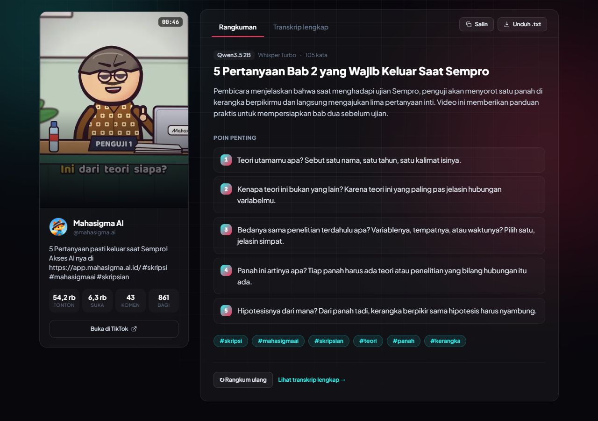
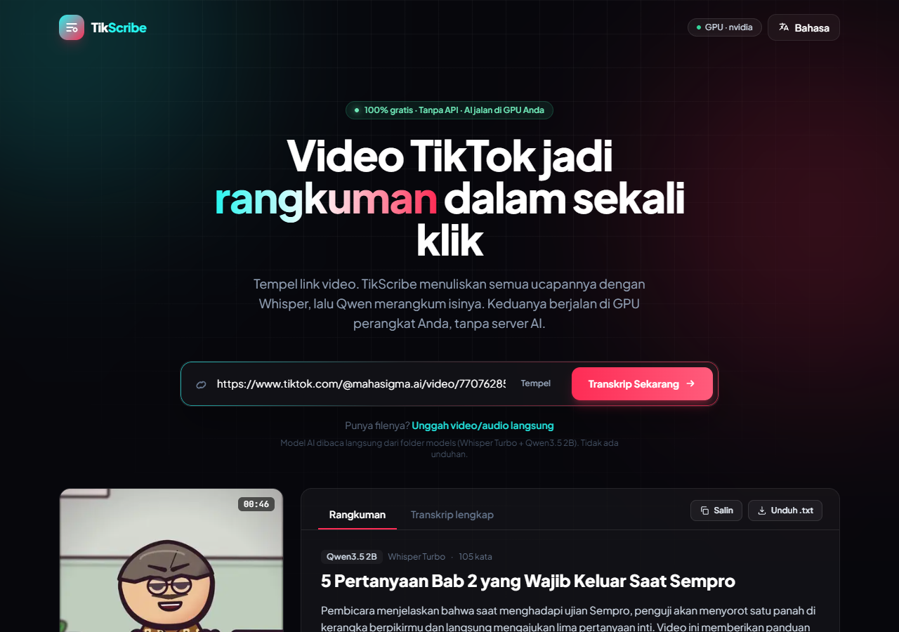
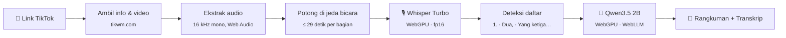

<div align="center">

# 🎬 TikScribe

### Video TikTok jadi transkrip lengkap & rangkuman, dalam sekali klik.

**100% gratis · Tanpa API key · Tanpa server AI · AI berjalan di GPU kamu sendiri**

[](https://finolut.github.io/TikScribe/)
[](https://developer.mozilla.org/docs/Web/API/WebGPU_API)
[](#-cara-kerja)




</div>

---

## ✨ Kenapa TikScribe?

Kebanyakan alat transkrip mengirim audio kamu ke server dan meminta API key berbayar. **TikScribe berbeda:** dua model AI dijalankan **langsung di browser**, memakai GPU perangkat kamu lewat WebGPU. Tidak ada biaya, tidak ada akun, dan audio tidak pernah dikirim ke server AI mana pun.

| | Fitur |
|---|---|
| 🎙️ | **Transkrip lengkap** dengan Whisper large-v3-turbo, tanpa potongan, dengan tampilan paragraf atau per waktu |
| 🧠 | **Rangkuman natural**: judul, ringkasan, poin penting, dan topik, ditulis oleh Qwen3.5 di GPU kamu |
| 📋 | **Daftar tidak pernah terlewat**: "5 tips", "pertama, kedua…" terdeteksi otomatis, setiap butir jadi satu poin |
| ⚡ | **Cepat**: video 46 detik selesai ±35 detik di GPU laptop RTX 2050 |
| 🔒 | **Privat**: audio diproses di perangkat sendiri, riwayat hanya tersimpan di browser |
| 🔍 | Cari kata di transkrip, salin, unduh `.txt`, plus riwayat video |
| 📦 | **Offline-ready**: library & model bisa disimpan di folder project, tidak perlu unduh ulang |

<div align="center">

</div>

---

## 🧩 Cara kerja



Beberapa detail yang membuat hasilnya akurat:

- **Potong di jeda, bukan di tengah kata.** Audio dibagi di titik paling sunyi (energi dihaluskan ±400 ms), sehingga Whisper tidak melewatkan kalimat di sambungan.
- **Jaring pengaman.** Kalau satu bagian menghasilkan kata jauh lebih sedikit daripada lama orang bicara, bagian itu didengarkan ulang dalam dua potongan lebih pendek.
- **Penjaga loop.** Kalau Whisper mulai mengulang token ("1 1 1 1…"), proses dihentikan dan otomatis pindah ke CPU, jadi tidak berputar tanpa akhir.
- **Satu model per GPU.** Whisper (±1,5 GB) dan Qwen (±2,2 GB) bergantian memakai GPU, sehingga laptop dengan VRAM 4 GB pun cukup.
- **Validasi rangkuman.** Jumlah poin dicek terhadap daftar yang diucapkan. Kalau ada yang hilang atau tergabung, model diminta memperbaiki. Kalau masih salah, poin diambil dari kalimat asli pembicara.

---

## 🚀 Cara pakai

### Opsi 1 · Langsung di web
Buka **[finolut.github.io/TikScribe](https://finolut.github.io/TikScribe/)** di **Chrome atau Edge**, tempel link TikTok, lalu klik **Transkrip Sekarang**.

> Kunjungan pertama mengunduh model (±2,8 GB) dari Hugging Face **sekali saja**. Setelah itu model tersimpan di cache browser.

### Opsi 2 · Jalankan di komputer sendiri (Windows)

```bash
git clone https://github.com/Finolut/TikScribe.git
```

Lalu klik dua kali **`Jalankan TikScribe.bat`**. Skrip ini akan:

1. mengunduh model AI **sekali** ke folder `models/` (unduhan paralel dan bisa dilanjutkan bila terputus),
2. menjalankan server lokal kecil (PowerShell bawaan Windows, tanpa install apa pun),
3. membuka Chrome/Edge dalam jendela aplikasi yang **dipaksa memakai GPU NVIDIA/AMD**.

Model dibaca langsung dari disk: tidak ada unduhan ulang dan tidak ada salinan di penyimpanan browser.

<details>
<summary><b>macOS / Linux</b></summary>

```bash
bash tools/download-models.sh     # sekali saja
python3 -m http.server 8000       # lalu buka http://localhost:8000 di Chrome/Edge
```
</details>

---

## 💻 Kebutuhan

| | Minimal | Disarankan |
|---|---|---|
| Browser | Chrome / Edge terbaru | Chrome / Edge terbaru |
| GPU | WebGPU + `shader-f16` (Intel Iris Xe / Arc, AMD, NVIDIA) | NVIDIA RTX / AMD RX |
| VRAM | ±3 GB | 4 GB+ |
| Penyimpanan | ±2,8 GB untuk model (sekali) | |

> **Laptop dengan dua GPU?** Supaya cepat, atur Chrome ke *High performance* di **Settings Windows → Display → Graphics**. `Jalankan TikScribe.bat` sudah melakukannya otomatis untuk jendelanya sendiri.
>
> **Firefox** belum stabil menjalankan model ini di WebGPU (hasilnya bisa rusak), jadi di Firefox TikScribe otomatis memakai mode CPU yang lebih lambat.

### ⏱️ Performa terukur
Video 46 detik, laptop RTX 2050 4 GB, Chrome:

| Tahap | Waktu |
|---|---|
| Info & audio | ±3 detik |
| Transkripsi (Whisper Turbo, GPU NVIDIA) | ±9–11 detik |
| Transkripsi (GPU Intel bawaan) | ±32–38 detik |
| Rangkuman (Qwen3.5 2B) | ±18–23 detik |
| **Total** | **±33–38 detik** |

---

## 🛠️ Teknologi

| Bagian | Teknologi |
|---|---|
| Speech-to-text | [Whisper large-v3-turbo](https://huggingface.co/onnx-community/whisper-large-v3-turbo) (ONNX, encoder fp16 + decoder q4f16) via [Transformers.js](https://github.com/huggingface/transformers.js) |
| Fallback CPU | [Whisper Base](https://huggingface.co/onnx-community/whisper-base) via ONNX Runtime Web (WASM) |
| Rangkuman | [Qwen3.5 2B](https://huggingface.co/mlc-ai/Qwen3.5-2B-q4f16_1-MLC) (q4f16) via [WebLLM](https://github.com/mlc-ai/web-llm) |
| UI | HTML + JavaScript murni, [Tailwind CSS](https://tailwindcss.com) |
| Concurrency | Web Workers (Whisper & Qwen tidak memblokir UI) |
| Data video | [tikwm.com](https://www.tikwm.com) (publik, tanpa key) |

---

## 📁 Struktur project

```
tikscribe/
├── index.html                 # seluruh aplikasi dalam satu file
├── Jalankan TikScribe.bat     # unduh model (sekali) + server lokal + buka Chrome
├── tools/
│   ├── server.ps1             # server statis kecil (PowerShell, tanpa install)
│   ├── download-models.ps1    # pengunduh model Windows (paralel, bisa dilanjutkan)
│   └── download-models.sh     # pengunduh model macOS / Linux
├── vendor/                    # Tailwind, Transformers.js, ONNX Runtime, WebLLM (lokal)
├── docs/                      # screenshot untuk README
└── models/                    # model AI (dibuat oleh pengunduh, tidak ikut Git)
```

> `models/` ada di `.gitignore` karena GitHub menolak file di atas 100 MB (encoder Whisper saja 1,2 GB). Kalau folder ini tidak ada, misalnya di GitHub Pages, aplikasi otomatis memuat model dari Hugging Face.

---

## 🌐 Deploy sendiri ke GitHub Pages

1. Fork repo ini ke akun GitHub kamu (public).
2. **Settings → Pages → Source: Deploy from a branch → `main` / root → Save**.
3. Tunggu ±1 menit, lalu buka `https://USERNAME-KAMU.github.io/TikScribe/`.

Tidak perlu build step, backend, atau environment variable apa pun.

---

## ⚠️ Keterbatasan

- Butuh WebGPU dengan fp16. Di HP dan browser lama, aplikasi jatuh ke mode CPU yang lebih lambat dan kurang akurat.
- Qwen3.5 2B adalah model kecil, jadi rangkumannya kadang kurang rapi. Isi daftar dijaga oleh validasi otomatis.
- Info dan video diambil lewat layanan pihak ketiga (tikwm.com). Kalau layanan itu sedang down, gunakan tombol **Unggah video/audio langsung**.
- Hanya untuk video publik.

---

## 🙏 Kredit

- [OpenAI Whisper](https://github.com/openai/whisper) · [ONNX Community](https://huggingface.co/onnx-community)
- [Qwen](https://github.com/QwenLM) · [MLC AI / WebLLM](https://github.com/mlc-ai/web-llm)
- [Hugging Face Transformers.js](https://github.com/huggingface/transformers.js) · [ONNX Runtime Web](https://onnxruntime.ai)

Model dan library mengikuti lisensinya masing-masing.

<div align="center">

---

**TikScribe** tidak berafiliasi dengan TikTok atau ByteDance.

Dibuat dengan ☕ dan WebGPU · Kalau project ini berguna, kasih ⭐ ya!

</div>
